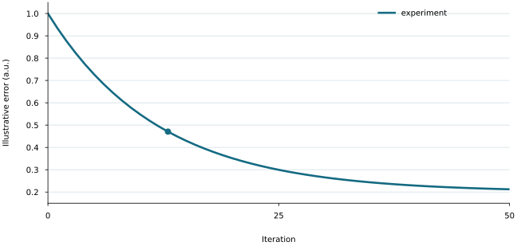

# Modern Scientific Presentations with Marp and SVG

> Build a single version-controlled scientific presentation, generate its SVG figures, and adapt both slide and figure typography for different venues by selecting a CSS theme at export.

Companion repository: [github.com/bgallois/marp_tuto](https://github.com/bgallois/marp_tuto)

Live demonstration: [bgallois.github.io/marp_tuto](https://bgallois.github.io/marp_tuto/)

## 1. Introduction

Scientific presentations change alongside research results. Analyses are repeated, figures are redrawn, and the same material is often reused for different audiences. Each new talk usually means revisiting an existing deck rather than starting from scratch.

Keeping the presentation in Markdown makes it easy to track and review changes to text, equations, and slide order. Marp also separates content from visual styling: typography, colors, margins, and recurring elements live in CSS themes instead of being adjusted slide by slide.

Figures introduce a second styling boundary. Labels that work on a laptop may be too small in a lecture room, while a white plotting area can be distracting in a dark presentation. SVG is useful here for two reasons. It stays sharp when resized, and its markup can (or not) be styled with CSS when it is part (or not) of the slide document.

The companion project demonstrates both approaches with one Matplotlib figure:

- The external image keeps its generated appearance.
- The inline copy takes its background, text color, and text size from the selected Marp theme.

A small repository-local plugin performs the inlining during the Marp build. Python still owns the plot and its scientific content; the theme controls only the visual properties that need to change with the venue. The same `slides.md` then builds online, dark-room, and bright-room variants.

## 2. Install Marp and run the demonstration

### Install Marp CLI in a project

Marp CLI can be installed locally with npm. A local installation keeps the version with the project and avoids requiring collaborators to install a global command.

You need Node.js 18 or newer and npm. Note that PDF, PowerPoint, and some image exports also require a browser supported by Marp CLI.

```sh
mkdir scientific-slides

cd scientific-slides

npm init -y

npm install --save-dev --save-exact @marp-team/marp-cli
```

Commit both `package.json` and `package-lock.json`. Other machines can then restore the same CLI version with `npm ci` and run it through `npx marp` or npm scripts.

### Run the companion project

The companion project is a pre-built slide deck that demonstrates everything we will present in this article. The repository also requires Python 3.11 or newer for its pinned NumPy and Matplotlib dependencies. Clone it and create a virtual environment:

```sh
git clone https://github.com/bgallois/marp_tuto.git

cd marp_tuto

python3 -m venv .venv

source .venv/bin/activate
```

Install the Python and Node dependencies:

```sh
python -m pip install --upgrade pip

python -m pip install --requirement requirements.txt

npm ci
```

Generate the SVG and build the three presentation variants:

```sh
npm run figures

npm run build:all
```

Figure generation is intentionally separate from presentation export. Run `npm run figures` when the data or plot code changes; `npm run build:all` rebuilds the presentations from the current SVG.

The build produces:

```text
dist/

├── index.html

├── online.html

├── dark-room.html

├── bright-room.html

└── figures/

    └── error.svg
```

Open `dist/index.html` to choose a variant. During editing, use:

```sh
npm run preview
```

The preview command uses the online theme. The plugin reads `figures/error.svg` during conversion. If an SVG change is not detected, save `slides.md` or restart the preview.

The relevant files are:

```text
marp_tuto/

├── slides.md

├── marp.config.mjs

├── package.json

├── package-lock.json

├── requirements.txt

├── figures/

│   ├── generate_error.py

│   └── error.svg

├── plugins/

│   └── inline-svg.mjs

├── scripts/

│   ├── copy-assets.mjs

│   └── generate-index.mjs

├── themes/

│   ├── base.css

│   ├── online.css

│   ├── dark-room.css

│   └── bright-room.css

└── .github/workflows/

    └── pages.yml
```

## 3. Create a first Marp presentation

A Marp presentation is a Markdown file with a YAML header:

```markdown
---

marp: true

theme: default

size: 16:9

paginate: true

---

<!-- _class: lead -->

<!-- _paginate: false -->

# From an analysis to a presentation

An example with synthetic data

---

# What should this figure explain?

- Define the quantity being displayed.

- Show the relevant comparison.

- Discuss the results.
```

The header sets global options, and `---` separates slides. Marp directives control individual slides: `_class: lead` selects the lead layout for that slide, while `_paginate: false` hides its page number. The underscore limits a directive to the current slide.

With a local installation:

```sh
npx marp slides.md
```

In the companion repository, the npm scripts already supply the custom themes and load the inline-SVG plugin through `marp.config.mjs`.

## 4. Include a conventional scientific figure

Marp supports standard Markdown image syntax with sizing and placement options:

```markdown
# Analysis results


```

An SVG included this way remains sharp at different sizes. Marp can also place it in a background region:

```markdown


# Analysis results

The error decreases rapidly during the first iterations, then stabilizes.
```

The image occupies the right 55% of the slide, and `contain` fits it without cropping. This is a good default for a reviewed figure that should keep the same internal styling everywhere.

### Asset paths in generated HTML

External image paths are resolved relative to the generated HTML. If `dist/online.html` contains:

```html

```

the browser looks for `dist/figures/error.svg`, not the source file at `figures/error.svg`.

The companion project’s `assets` script copies the figure before each theme build:

```json
"assets": "node scripts/copy-assets.mjs"
```

This keeps the same relative path in the source and generated presentation. The inline copy does not need a separate asset, but the external-image slide does.

## 5. Generate an SVG that CSS can style

Inlining only helps if the SVG contains elements CSS can address. Matplotlib normally converts SVG text to paths, so the first requirement is to preserve text:

```python
plt.rcParams["svg.fonttype"] = "none"
```

The figure is generated by `figures/generate_error.py`.  Preserving `<text>` elements lets the theme change their font, size, and fill. It also means a suitable font must be available in the browser. This project inherits the slide font and falls back to Arial.

After saving, the script uses `ElementTree` to add:

- `class="figure"` on the root `<svg>`
- a white fallback background for external-image use
- `role="img"`, `<title>`, and `<desc>` metadata

That root class and the SVG `<text>` elements are the complete styling interface used by this proof of concept. The curve, grid, and individual axes keep their Matplotlib styles.

## 6. External SVG versus inline SVG

The choice is between preserving a figure’s own appearance and exposing its elements to the presentation stylesheet.

| Property                          | Conventional image | Build-time inline SVG   |
| --------------------------------- | ------------------ | ----------------------- |
| Syntax                            | ``    | `@[svg](figure.svg)`      |
| Native Marp syntax                | Yes                | No; local plugin        |
| Separate source file              | Yes                | Yes                     |
| Theme can style internal elements | No                 | Yes                     |
| Generated HTML needs the asset    | Yes                | No for the inline copy  |
| Useful default                    | Fixed-style figure | Theme-responsive figure |

### Why keep an SVG external?

Use a conventional image when a publication-ready figure, branded diagram, or reviewed illustration must look the same everywhere. The presentation can control its size, position, opacity, and layout, but it cannot select the legend or axes inside the image.

### Why inline an SVG?

Inline SVG is useful when legibility or contrast should follow the presentation setting. The companion themes make a deliberately limited set of changes:

- Online: 14 px plot text on a white plotting surface.
- Dark room: an `#172033` plotting surface with light 18 px text.
- Bright room: a white plotting surface with black 22 px text.

The same generated file supports all three variants. It is not regenerated when the theme changes.

For more detailed adaptation, add stable classes to the SVG elements that should change and target those classes from the theme. Avoid relying on generated Matplotlib IDs, which may change when the figure is regenerated. The current project does not add semantic classes for individual lines, labels, or legends.

## 7. Add the repository-local inline-SVG plugin

Pasting SVG markup directly into `slides.md` would make it styleable, but it would also mix generated output with the presentation source. The local plugin keeps the SVG in a separate file and inserts it during conversion.

`@[svg](...)` is not built into Marp. It is implemented in `plugins/inline-svg.mjs` and registered by `marp.config.mjs`:

```javascript
import inlineSvg from './plugins/inline-svg.mjs'

export default {

  engine: ({ marp }) => marp.use(inlineSvg, { root: process.cwd() }),

}
```

The plugin adds a Markdown block rule that:

1. Matches a line containing `@[svg](path/to/figure.svg)`.
2. Resolves the SVG path relative to the project root.
3. Rejects paths outside the project.
4. Reads the file.
5. Removes XML declarations and doctypes that cannot appear inside HTML.
6. Emits the remaining markup as an HTML block.

The deck enables HTML in its front matter, and the build scripts pass `--html`:

```yaml
html: true
```

The plugin inserts SVG verbatim and does not sanitize it. Use it only with trusted files.

## 8. Create theme variants

Once the SVG is part of the slide document, the Marp theme can reach it with ordinary CSS. The themes use a short import chain:

```text
Marp default

└── themes/base.css

    ├── themes/online.css

    ├── themes/dark-room.css

    └── themes/bright-room.css
```

The base theme inherits Marp’s built-in default theme and defines the shared rules:

```css
/* @theme base */

@import "default";

section {

  background: var(--slide-background);

  color: var(--slide-text);

 font-family: Inter, Arial, sans-serif;

}

.figure {

  background: var(--plot-background) !important;

  display: block;

  margin: 0 auto;

  width: 82%;

}

.figure text {

  fill: var(--plot-text) !important;

  font-family: inherit;

 font-size: var(--plot-text-size) !important;

}
```

Each venue theme imports `base` and sets custom properties. The dark-room theme is:

```css
/* @theme dark-room */

@import "base";

:root {

  --slide-background: #111827;

  --slide-text: #e5eef7;

  --accent: #67e8f9;

  --muted-text: #a7b6c6;

  --plot-background: #172033;

  --plot-grid: #405069;

  --plot-text: #f5f9fc;

  --plot-text-size: 18px;

}
```

Generate a specific variant with:

```sh
npm run build:online

npm run build:dark

npm run build:bright
```

All three commands use the same `slides.md` and `figures/error.svg`. The scripts select a theme with Marp’s `--theme` option.

## 9. Export HTML, PDF, and PowerPoint

### HTML

```sh
npm run build:all
```

This builds the three decks and `dist/index.html`. The inline SVG markup is part of each HTML file, while the conventional image still needs `dist/figures/error.svg`.

### PDF

Use the same explicit theme set when exporting PDF:

```sh
npx marp slides.md \

  --theme-set themes/base.css \

  --theme-set themes/online.css \

  --theme-set themes/dark-room.css \

  --theme-set themes/bright-room.css \

  --theme online \

  --html \

  --pdf \

  --allow-local-files \

  --output dist/slides.pdf
```

`--allow-local-files` lets the browser load the external SVG and should only be used with trusted input. PDF is static, so fragmented lists appear fully revealed.

### PowerPoint

Replace `--pdf` with `--pptx` and change the output extension:

```sh
npx marp slides.md \

  --theme-set themes/base.css \

  --theme-set themes/online.css \

  --theme-set themes/dark-room.css \

  --theme-set themes/bright-room.css \

  --theme online \

  --html \

  --pptx \

  --allow-local-files \

  --output dist/slides.pptx
```

Standard Marp PPTX output renders each slide as an image. Text and SVG elements are therefore not separate editable PowerPoint objects. Marp also has an experimental `--pptx-editable` mode that requires LibreOffice, but complex styling may not reproduce the HTML layout exactly.

## 10. Extend the approach to other scientific figures

The demonstration uses a Matplotlib plot, but the same boundary applies to SVGs edited in Inkscape or assembled from several sources. Keep generated files separate from manually edited illustrations so rerunning an analysis does not overwrite manual work:

```text
figures/

├── generated/

│   └── error.svg

└── illustrations/

    └── annotated-error.svg
```

Inkscape and plotting libraries can add inline styles, generated IDs, clip paths, and metadata. Before using an edited SVG inline:

- Preserve its `viewBox` so it scales correctly.
- Add stable classes only where theme control is required.
- Avoid highly specific inline styles on theme-controlled elements.
- Include `<title>` and `<desc>` for accessibility.
- Keep IDs used by gradients, masks, and clip paths unique.

Raster content can remain within an SVG, while axes, annotations, and labels remain vector-based. For dense plots, Matplotlib can rasterize selected artists:

```python
fig, ax = plt.subplots(layout="constrained")

ax.scatter(x, y, s=2, rasterized=True)

ax.set(

    xlabel="Principal component 1",

    ylabel="Principal component 2",

)

fig.savefig("figures/dense-scatter.svg", dpi=200)

plt.close(fig)
```

This can reduce file size without rasterizing the surrounding labels and axes. Choose the raster resolution for the size at which the figure will be presented.

## 11. Keep the rest of the deck in normal Marp

The inline-SVG rule is limited to its custom directive. The rest of `slides.md` remains ordinary Marp Markdown.

### Code and mathematics

The front matter selects MathJax:

```yaml
math: mathjax
```

A slide can then combine syntax-highlighted code and a display equation:

````markdown
```python
iteration = np.arange(51)

error = 0.2 + 0.8 * np.exp(-iteration / 12)
```

$$
e_k = 0.2 + 0.8\exp\left(-\frac{k}{12}\right)

$$
````

### Progressive lists

In Marp’s HTML presentation, lists marked with `*` are fragmented and revealed item by item:

```markdown


# Image + progressive text

* The curve falls rapidly at first.

* Improvement slows after 25 iterations.

* The final error approaches a plateau.
```

PDF and PowerPoint exports are static, so all items appear together.

### Two progressive text columns

The deck uses a custom two-column text layout with a scoped CSS grid in its YAML header. A local class directive applies the layout to one slide:

```markdown
<!-- _class: dual-text -->

# Two progressive text columns

## Observations

* Fast initial decrease

* Stable final plateau

## Next steps

* Compare repeated experiments

* Report uncertainty
```

The selectors in `slides.md` place each heading and its following list in a separate grid column. Scoping the rules to `section.dual-text` prevents them from changing other slides. Fragment order still follows the Markdown source: left-column items appear before right-column items.

### Transitions

Marp can apply a transition globally from the front matter or locally to one slide:

```markdown
transition: fade

<!-- _transition: fade -->
```

Transitions depend on browser support for the View Transition API. They remain an HTML presentation feature and are not exported as PowerPoint animations.

### Video

With HTML enabled, a slide can contain a standard video element:

```html
<video

  controls

  muted

  loop

  src="media/trajectory.mp4"

  poster="media/trajectory-poster.png"

  width="960">

</video>
```

Include the video and poster files when sharing the HTML presentation. Video does not play in PDF or PowerPoint exports.

## 12. Maintain and publish the workflow

The complete local build remains two commands:

```sh
npm run figures

npm run build:all
```

The Python and presentation builds stay separate so a slide-only edit does not regenerate the figure. `requirements.txt`, `package-lock.json`, and the exact Marp CLI version in `package.json` record the dependencies used by the project.

Automation does not validate the scientific interpretation. When data changes, regenerate the figure and review slide titles, values, and conclusions. For important milestones, keep the exported PDF with the source; later exports can vary with fonts, browsers, and rendering engines.

## 13. Conclusion

The useful part of this approach is the boundary between generated data and presentation styling. Python owns the plot and its scientific content, a small, explicit CSS surface lets Marp adapt the surrounding presentation and figure typography to its venue.

Not every SVG should be inline. A fixed external image is preferable when exact appearance matters more than adaptation. Keeping both options available makes the decision local to each figure, without duplicating the deck or editing the generated output by hand.
