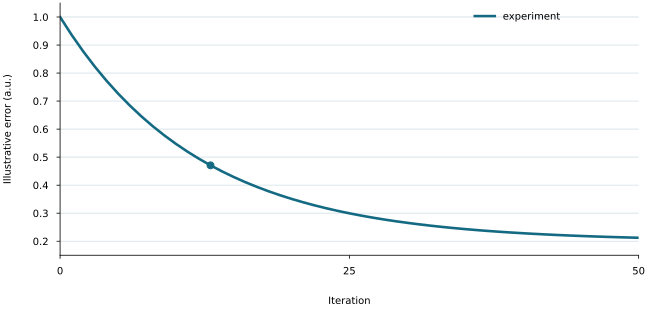

<!-- _class: lead -->
<!-- _paginate: false -->

# One source, several settings

A minimal theme-aware scientific figure

---

<span class="theme-name">The build command selects the theme</span>

# Inline SVG: the figure follows the theme

@[svg](figures/error.svg)

---

<span class="theme-name">Standard Markdown image</span>

# External SVG: the figure keeps its own style



The slide theme cannot select elements inside this image.

---

# The model as code and mathematics

```python
iteration = np.arange(51)
error = 0.2 + 0.8 * np.exp(-iteration / 12)
```

The same synthetic decay written mathematically:

$$
e_k = 0.2 + 0.8\exp\left(-\frac{k}{12}\right)
$$

---


# Image + progressive text

* The curve falls rapidly at first.
* Improvement slows after 25 iterations.
* The final error approaches a plateau.

---

<!-- _class: dual-text -->

# Two progressive text columns

## Observations

* Fast initial decrease
* Stable final plateau

## Next steps

* Compare repeated experiments
* Report uncertainty
